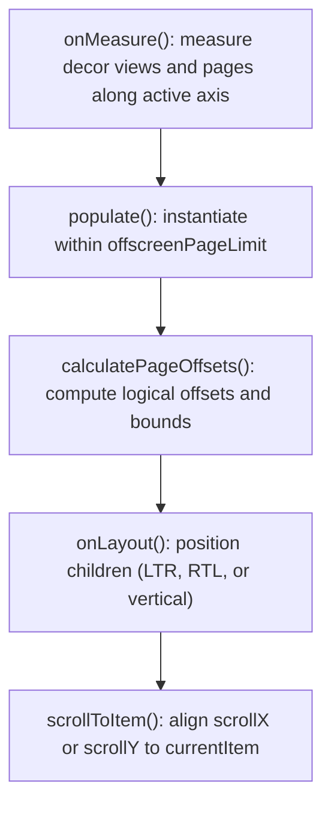
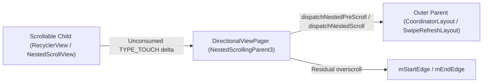

# Architecture and internals

This document explains how [DirectionalViewPager](../library/src/main/kotlin/androidx/viewpager/widget/DirectionalViewPager.kt) supports dual-axis paging, RTL coordinate mirroring, and nested scrolling while preserving binary and source compatibility with AndroidX `ViewPager`.

## Package placement and adapter parity

`DirectionalViewPager` resides in package `androidx.viewpager.widget` rather than `androidx.directionalviewpager`.
AndroidX `PagerAdapter.setViewPagerObserver(DataSetObserver)` is package-private in Java, so residing in `androidx.viewpager.widget` lets `DirectionalViewPager` wire dataset change notifications without reflection and reuse `ViewPager.OnPageChangeListener`, `ViewPager.PageTransformer`, and `ViewPager.DecorView` directly.

## Axis abstraction and layout lifecycle

Page state is stored in orientation-neutral `ItemInfo` records (`position`, `offset`, and `sizeFactor`) where `sizeFactor` bridges to `PagerAdapter.getPageWidth(position)` via an internal `getPageSize(position)` helper.

When `isHorizontal` changes at runtime, active touch state clears, `recalculateOffsetsForOrientationChange()` recomputes `curInfo.offset` using the new axis `mPageMargin / clientSize` ratio, `populate()` updates neighboring pages, and `scrollToItem()` aligns the active axis scroll position.

## Horizontal RTL coordinate strategy

Rather than inverting adapter indices or `ItemInfo.offset` values, RTL mirroring happens strictly at layout, scroll, and input boundaries when `isRtlHorizontal()` returns `true` (`isHorizontal && layoutDirection == LAYOUT_DIRECTION_RTL`):

- **Logical offsets**: `ItemInfo.offset`, `mFirstOffset`, and `mLastOffset` remain non-negative logical values (`0f`, `1f`, ...).
- **Physical coordinates**: Horizontal `scrollX` values and `onLayout` child coordinates negate relative to the right edge (`paddingLeft + childWidth - childWidth * (offset + sizeFactor)`).
- **Re-entrant padding guard**: Calling `scrollToItem()` directly inside `onRtlPropertiesChanged()` re-enters `View.resolvePadding()` before padding flags settle and causes a `StackOverflowError`. Instead, `onRtlPropertiesChanged()` sets `mPendingScrollToCurrentItem = true` and calls `requestLayout()`, deferring `scrollToItem()` to the end of `onLayout()`.

## Nested scroll delegation

`DirectionalViewPager` acts as both a nested scroll parent for scrollable page children and a nested scroll child for outer containers.

During direct touch drags (`performDragX` / `performDragY`), `dispatchNestedPreScroll` runs before `performDragDeltaX` / `performDragDeltaY`, and any boundary overscroll passes to `dispatchNestedScroll` before pulling `mStartEdge` or `mEndEdge`.
During nested child drags (`onNestedScroll`), `DirectionalViewPager` consumes `dxUnconsumed` or `dyUnconsumed` along its active axis, records consumption in `consumed`, forwards leftovers to any outer parent, and settles to `determineTargetPage()` in `onStopNestedScroll()`.
